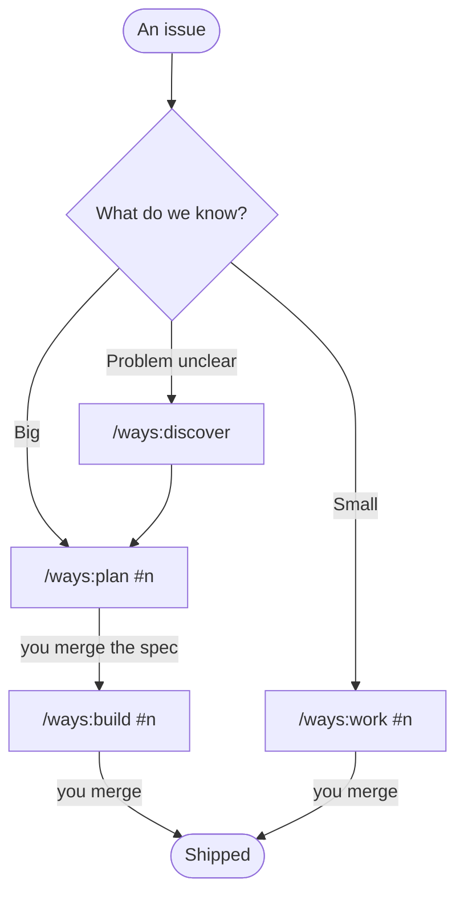
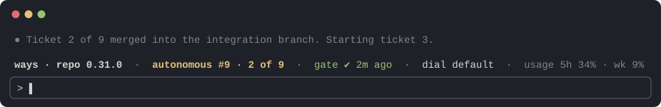

# Ways of working

**A Claude Code plugin that gives a team one agreed way to take work from an issue to a merged PR. Claude does the building. People make the decisions.**

It sits on top of [Matt Pocock's skills](https://github.com/mattpocock/skills), which cover the engineering disciplines (grilling a plan, writing a spec, cutting tickets, test-driven development, code review). Ways adds what a team has to agree on once: where specs live, how big work is planned, when Claude works on its own, what has to pass before anything merges, and who approves what.

| | |
|---|---|
| **Borrowed** | Matt Pocock's skills, used as they are: the grill, domain modelling, `to-spec`, `to-tickets`, `implement-spec`, TDD, code review, triage, diagnosing bugs, prototypes. And Ofer Regev's [discovery-to-mvp](https://github.com/oferregev81pt/discovery-to-mvp), inside `/ways:discover` (MIT; the changes are in its notice). |
| **Joined up** | `/ways:plan`, `/ways:build` and `/ways:work` run those pieces in the right order, resume where they left off, and keep their state in GitHub. |
| **Added** | What was missing: technical design (C4, parts, contracts, ADRs), mocks with a guided tour, setup, the hooks that hold the gate, the status band, proportion. |
| **Opinionated** | Standards that say what checks them, routing by kind of work, review sized to risk, a model chosen per ticket. |

The best building blocks, joined up, with what was missing added, and opinionated enough for a team to rely on. Pocock's skills do the heavy lifting; ways is the operating model around them.

## Why

Coding agents are fast. What goes wrong is everything around the code:

- **Nobody agreed what to build**, so the agent guesses, and the guess ships.
- **Work isn't checked the same way twice**, so "done" means whatever this session decided.
- **PRs are hard to review**: big, unexplained, and missing how to check them.
- **It over-builds.** Every step adds a little, and a modest feature ends up five times the size it needed to be ([measured](#measured)).

Ways answers each of those with a step a person can see, and a check that holds when nobody is watching.

## What you get

| | |
|---|---|
| 🧭 **One flow** | Four commands cover discovery, planning, building and small fixes. Each one tells you where you are and what comes next. |
| 📄 **Specs in the repo** | Requirements and design go in a PRD file, agreed in one PR. Status lives in GitHub issues, not in a chat. |
| 🤖 **Interactive or autonomous** | Work alongside Claude, or let it build a whole spec on its own while the **gate** (your tests, lint and checks, as one command) holds every step. Or on a schedule, overnight ([Scheduled runs](#scheduled-runs)). |
| ✅ **Merge by risk** | Low-risk changes can merge themselves once CI is green. High-risk ones need a code owner. A dial in each repo sets how much people review ([the policy](plugins/ways/reference/REVIEW-AND-MERGE.md)). |
| 📏 **Built in proportion** | Plans recommend the minimal answer, state the expected size up front, and the build is checked against it. |
| 📝 **The PR is the report** | Every PR says what changed, what was checked, and how a person can check it. |
| 💻 **Any platform** | Windows, macOS and Linux, in the same team. |

## Install

```bash
claude plugin marketplace add anthropics/claude-plugins-official
claude plugin marketplace add rattling/ways-of-working
claude plugin install ways@ways-of-working
```

Then, in a repo, run **`/ways:setup`**. It adds the files, labels and CI check the method needs, never overwrites what's already there, and opens a PR for you to review. Run it again after an update to bring the repo up to date.

You'll also need [`gh`](https://cli.github.com/), signed in. Installing `ways` installs Pocock's skills with it, and a repo set up with ways offers the same plugins to anyone who opens it in Claude Code.

## How work flows



| Command | Use it when | You end up with |
|---|---|---|
| `/ways:discover` | The ask is a wish list, an idea or a half-built app, and nobody can say what problem it solves | A one-page brief and an issue to plan from |
| `/ways:plan #n` | The work is big: more than one ticket, or it changes a rule or a contract | One spec PR: what it does, how the system changes, and how big it should be |
| `/ways:build #n` | The spec is merged | Tickets, the code on one branch, a review, and one PR to ship it |
| `/ways:work #n` | The work is small: a bug, an enhancement | One reviewed PR, from a raw issue if need be |

**A person types each command.** Claude never starts the next step itself, because each one is a point where someone decides to move on. Every command checks what's already done, so running it twice never repeats work, and ends by naming the one PR to merge and the next command.

The full routing table, with what counts as big and the only two shortcuts allowed, is [How work goes](plugins/ways/templates/AGENTS.md#how-work-goes). Setup copies it into every repo.

### Also useful

| Command | What it does |
|---|---|
| `/ways:setup` | Sets a repo up, or brings it up to date |
| `/ways:mock` | A clickable mock of a page, printout or chart, with real data, kept as the picture the build must match |
| `/ways:explain` | A visual explainer of how a repo works, for someone new to it |
| `/ways:arch-review` | A guided architecture review, ending in a critique to turn into tickets |
| `/ways:requirements`, `/ways:design` | The two halves of a plan, for when different people do them |
| `/ways:feedback` | Tells this repo how ways worked for you, as an issue |

<details>
<summary><b>More about each command</b></summary>

- **`/ways:setup`** seeds the files below, the standards, the labels, a `pr-hygiene` CI check and Pocock's per-repo config, and stamps the repo with the version. On an update it replaces the sections the plugin owns and adds new standards sections, leaving the rest alone.
- **`/ways:discover`** works from interviews, notes, data and whatever's been built (put them in `specs/brief/inbox/`) to who hurts, how we'd know it's fixed, the workflows and an MVP. Sources that name people stay in a git-ignored `private/` folder. Quick mode stops three times; deep mode checks every quote. Built on Ofer Regev's [discovery-to-mvp](https://github.com/oferregev81pt/discovery-to-mvp) (MIT). [`examples/discovery/`](examples/discovery/) is a case to practise on, with an answer key.
- **`/ways:plan`** works out the requirements by prototyping, grilling or both, recommending the minimal answer each time and putting what's declined on a Later list. Then it designs at system level (parts, contracts, data, seams, and NFRs where they apply) and estimates the size beside the closest feature already in the repo. Everything goes into one PRD and one spec PR.
- **`/ways:build`** cuts a few tickets, each with an expected size, a human check, and a model chosen by what it changes (Sonnet for what follows a pattern, Opus for what changes a rule). It builds them one at a time on an integration branch, reviews the whole branch, walks the result in the running app, and compares the size with the estimate. It resumes a build under way.
- **`/ways:work`** takes one small issue (or a batch) interactively or autonomously: branch, plan, draft PR, test-driven build, Pocock's code review with every finding answered, a risk tier, and the PR body. From a raw issue it sizes it, reproduces a bug first, and waits for your go.
- **`/ways:mock`** is for anything people look at. Mocks come after the decisions, look like the finished product, and carry a guided tour. [`examples/mocks/`](examples/mocks/) has three.
- **`/ways:arch-review`** walks the pillars of a Well-Architected Review (reliability, security, cost, operations, performance) and ends with what holds, the one thing that would sink it, and the gaps.
- **`/ways:feedback`** drafts from the session, strips client and repo detail, shows you the text, and opens the issue only after a yes. The other commands note what could be better as they go and offer it at the end.

Pocock's skills run underneath and can still be typed on their own. `/ways:plan` uses `grilling`, `domain-modeling` and `to-spec`; `/ways:build` uses `to-tickets`, `implement-spec` and `code-review`. Ways calls them and adds its conventions; it doesn't copy them.

</details>

## Measured

The same request (an allergen chart for a café's menus, printable for the wall, that says when the printed copy is out of date), on the same app:

| | Plain prompt | ways 0.27: every gold-plated option accepted | **ways 0.29: proportion** |
|---|---|---|---|
| Lines | ~840 | ~4,980 | **~1,040** |
| Files | 14 | 52 | **14** |
| Build time | 7 min | 1 h 34 m | **29 min** |
| Tickets | none | 6, all Opus | **2** (Sonnet, Opus) |

A blind review of the plain and 0.29 builds (the reviewer didn't know which was which), out of 5:

| | Correctness | Fit with the codebase | Design | Security | Tests | Readability |
|---|---|---|---|---|---|---|
| Plain prompt | 3 | 3.5 | 3 | 5 | 3 | 3.5 |
| **ways 0.29** | **4** | **4** | **4** | **5** | **4.5** | **4** |

The plain build told staff a dish "no longer contains" allergens it couldn't work out; the ways build guarded that case and tested it. The plain build had the best single idea: a version code printed on each sheet.

A little more code buys an agreed spec, a review, and safer, better-tested code. The 0.27 column is what happens when a method oversteers, and it's why proportion is now built in: the extras (a history of printed copies, warnings on every page) went on a Later list instead of into the code.

*One feature and one review, so indicative, not proof. Build times leave out planning, and ways' 29 minutes includes a code review, a security review and a walk through the running app that the plain run didn't do.*

## What a repo holds

| Where | What | Who owns it |
|---|---|---|
| `specs/` | The charter, roadmap, operating context, and the PRDs | People |
| `GLOSSARY.md`, `docs/adr/`, `docs/ARCHITECTURE.md` | Language, decisions, shape | People decide; Claude drafts |
| `docs/standards/` | Architecture, code, testing, security, delivery and the stack, each rule with what checks it | Starts as the plugin's; the team makes it its own |
| `docs/agents/` | Where the skills find the tracker, labels and conventions | Setup writes it |
| Everything else | `AGENTS.md`, `REVIEW.md`, `.github/`, issues, PRs, tests | Claude builds; people review |

Four hooks keep it honest in every session:
- one orients Claude when it starts;
- one stops an autonomous run from ending on a red gate;
- one stops an autonomous run from pushing to `main`, or merging into it while the merge dial is on learning, which matters most where GitHub's free plan can't protect `main`;
- one nudges when a file grows past about 500 lines.

## Works with

- **Windows, macOS and Linux.** Hooks run in bash everywhere (Git Bash on Windows). A repo's gate is one command that runs as it is in PowerShell and bash, so `make` and `&&` are out.
- **Any stack.** Ways says what the gate *is* (one command, the same locally, in CI and for the agent), not what's in it: an npm script, `uv run`, `dotnet test`, Composer or Docker Compose. Setup picks the CI runner and toolchain for the stack, including Windows for .NET Framework ([CI by stack](plugins/ways/templates/docs/standards/delivery.md)).
- **Other agents.** Codex or another agent can work in a repo set up with ways: the files, conventions, CI and gate hold for anyone, and `AGENTS.md` says what to adapt. The hooks and the band are Claude Code only.

## Scheduled runs

ways doesn't schedule anything itself, but its autonomous runs work well on a schedule. We run one as a Claude Code routine on a private repo, firing hourly overnight. It does two things:
- triages new issues and works the small ones into PRs;
- finishes planned work: `/ways:build` on a spec whose tickets were approved during the day.

In the morning there are PRs to review. The usage window also gets spread across the day, so the hours you're at the keyboard stay yours.

It takes some setup:
- **A cloud environment for the routine.** It needs the ways plugin installed and network access to the domains your build needs.
- **A gate that runs there.** A cloud session has no Docker daemon, so the gate installs and starts what it needs (Postgres, MySQL) instead of relying on Compose.
- **Limits you choose.** Decide what it may do, and on which repos.

Some things to weigh:
- **Issue text is input to an agent.** Anyone who can open an issue can try to steer it. We only run on private repos, and screen issues for instructions aimed at the agent before it reads them.
- **`main` should be protected.** Merging and deploying stay with people. Where GitHub's free plan can't protect `main`, ways' hook refuses pushes to it in autonomous runs, and [`delivery.md`](plugins/ways/templates/docs/standards/delivery.md) has a deploy check.
- **The security posture is yours.** What it can reach, which secrets it holds, and what it may merge are your call.

We'll write up the patterns once they've settled ([#43](https://github.com/rattling/ways-of-working/issues/43)).

## `ways-band`: the status band

An optional second plugin that draws a line above the prompt in a ways repo: the mode and the issue, progress through a build, the gate, the merge dial, the branch, context and usage.



- **`/gate`** runs the repo's gate at once, with no Claude turn and no tokens.
- **A `usage` tool** lets an autonomous run report what it cost in its PR.

```bash
claude plugin install ways-band@ways-of-working
```

It's also a small worked example of a [mod](https://code.claude.com/docs/en/plugins/mods/overview): one file, [`register.js`](plugins/ways-band/hooks/register.js), with tests beside it. Mods run with your permissions. This one reads `.claude/ways.json`, `.ways/` and `AGENTS.md`, writes `.ways/last-gate`, runs `git branch` and, on `/gate`, the gate.

## Make it yours

The standards are a starting point. A team should end up owning its own:

- **Edit the repo's copy.** `docs/standards/` belongs to the repo once setup has copied it. Enough for one repo or a small team.
- **Fork this repo**, rewrite the standards and templates, and point your repos at your fork.
- **Add your own plugin on top** for your standards, deploys and internal services, and keep `ways` as it is.

Whichever you choose, keep one rule: a rule nothing checks is advice, so every rule you add says what enforces it. [`WORKING-CONTRACT.md`](WORKING-CONTRACT.md) has the reasoning behind who owns what.

## Where it came from

About 14 projects and 550 work items have been run this way, including a delivery tool built to enforce it, now parked: the practices didn't need it.

<details>
<summary><b>Four things I got wrong the first time</b></summary>

- **Enforcement in the tracker.** It refused to mark work done until the PR merged, but the PR merges whenever it likes, so the tracker's opinion arrives after the only irreversible step. A required CI check on the PR is harder to skip, and doesn't care which tool produced the diff.
- **A list of documents a project ought to have.** Nobody wrote them, me included. Each optional document now says when it's worth having, and that gets used, because the trigger arrives when the document would help.
- **Distributing by local path.** Repos read from a folder in my home directory, which worked for exactly one person and quietly rotted for everyone else.
- **Rules instead of reports.** An agent skips work it can skip invisibly, and so does a person. What holds is having to say what you did and didn't do, at the moment someone decides whether to accept it.

</details>

## Related

[**lore**](https://github.com/rattling/lore): patterns, gotchas and architectural lessons that outlive the project that taught them.

## Licence

[MIT](LICENSE).
