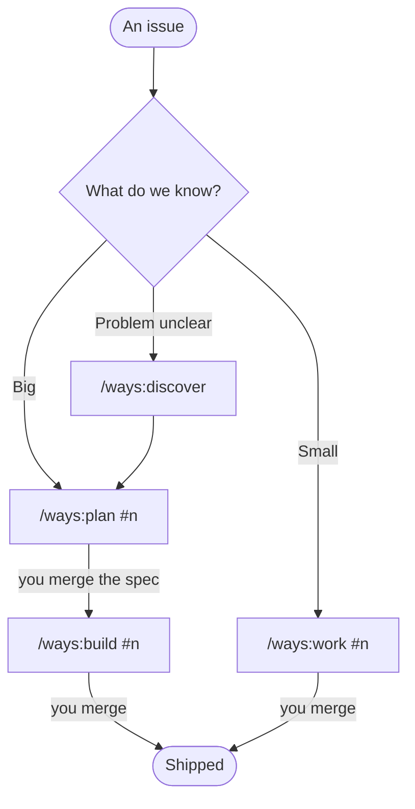

# Ways

Ways is our implementation of [the method](../method/): a Claude Code plugin that puts it in place, assembled and ready to use. If you'd rather build your own from the method, that works too. Ways is here so you don't have to.

## What ways brings

> **In short**
> - The best building blocks, joined up, with what was missing added.
> - Opinionated enough for a team to use out of the box.
> - Claude does the building; people make the decisions.

### Borrowed, joined up, added

| | |
|---|---|
| **Borrowed** | Matt Pocock's skills, used as they are: the grill, domain modelling, `to-spec`, `to-tickets`, `implement-spec`, TDD, code review, triage, diagnosing bugs, prototypes. And Ofer Regev's [discovery-to-mvp](https://github.com/oferregev81pt/discovery-to-mvp), inside `/ways:discover` (MIT; the changes are in its notice). |
| **Joined up** | `/ways:plan`, `/ways:build` and `/ways:work` run those pieces in the right order, resume where they left off, and keep their state in your issue tracker. |
| **Added** | What was missing: technical design (C4, parts, contracts, ADRs), mocks with a guided tour, setup, the hooks that hold the gate, the status band, proportion. |
| **Opinionated** | Standards that say what checks them, routing by kind of work, review sized to risk, a model chosen per ticket. |

Matt Pocock's skills do much of the heavy lifting inside; ways is the operating model around them.

### The flow



| Command | Use it when | You end up with |
|---|---|---|
| `/ways:discover` | The ask is a wish list, an idea or a half-built app, and nobody can say what problem it solves | A one-page brief and an issue to plan from |
| `/ways:plan #n` | The work is big: more than one ticket, or it changes a rule or a contract | One spec PR: what it does, how the system changes, and how big it should be |
| `/ways:build #n` | The spec is merged | Tickets, the code on one branch, a review, and one PR to ship it |
| `/ways:work #n` | The work is small: a bug, an enhancement | One reviewed PR, from a raw issue if need be |

A person types each command. Claude never starts the next step itself, because each one is a point where someone decides to move on. Every command checks what's already done, so running it twice never repeats work, and ends by naming the one PR to merge and the next command. To see it run, try [Issue to Merge](../issue-to-merge/).

## Area by area

> **In short**
> - How ways puts each area of the method in place.
> - What you'd copy if you built your own.

### Architecture

- **The standard and the template.** Setup copies `docs/standards/architecture.md` into the repo, and creates `docs/ARCHITECTURE.md` from a template with the sections above.
- **In ways:** the design step runs inside `/ways:plan`, and `/ways:arch-review` runs the review. The heart of the review skill:

  > Two or three lines before the pillars: does the shape still serve what the charter says this is for, and do the invariants still hold in the code? Drift here outranks anything a pillar finds. … For each pillar: say in two or three lines what you found, then ask about what's missing, unclear or drifted, in rounds: numbered questions, each with your recommended answer. … Don't file issues and don't write documents: the person turns the critique into tickets.

- **Your own:** a template, a paragraph in the map file ("a change that alters the shape updates the page and adds a decision record"), a review rule, and a review skill built from the prompt above.
- **Later:** a scheduled check that asks every week whether the architecture page is still true to the code, and opens an issue for a person to triage.

---

### How work flows

- **The templates and CI:** the PR and issue templates, a CI check that the PR links an issue and has a How to check (two checks only, because a gate that fails for six reasons gets disabled, and a `no-issue` label as the deliberate way round), the risk list in `REVIEW.md`, and owners in `CODEOWNERS`.
- **In ways:** a routing table in every repo's `AGENTS.md`, and four commands that walk the lifecycle. Each ends by naming the one PR to merge and the next command:

| Command | Use it when | You end up with |
|---|---|---|
| `/ways:discover` | The ask is a wish list, an idea or a half-built app | A one-page brief and an issue to plan from |
| `/ways:plan #n` | The work is big | One spec PR: what it does, how the system changes, how big it should be |
| `/ways:build #n` | The spec is merged | Tickets, the code on one branch, a review, and one PR to ship it |
| `/ways:work #n` | The work is small | One reviewed PR |


- **Your own:** the same templates and CI, plus a short "how work goes" section in the map file with your routing and your merge dial.

---

### Features

- **In ways:** `/ways:discover`, `/ways:plan` (requirements by prototype, grill or both, then the design) and `/ways:build`.
- **Your own:** a spec template with Must not exist yet, Human verification and Size; a paragraph telling the grill to lean small and keep a Later list; and the proportion rule in the architecture standard.

---

### Bugs

- **Issue templates** that label every new issue for triage.
- **In ways:** `/triage` for the queue, and `/ways:work #n` for one bug or several. The heart of it:

  > A bug: reproduce it first, before anything else. If it won't reproduce, say what you tried and ask for what would, and stop. Write the brief yourself: the outcome, acceptance criteria, what's out of scope, and human verification. Post it, with the reproduction, so the person sees what you think the job is before they say go.

- **Your own:** a triage paragraph and a "reproduce first, failing test first" rule in the map file.

---

### Testing and the gate

- **The gate recorded once,** where the hook and CI both read it:

  ```json
  {"gate": "docker compose run --rm --build app composer check"}
  ```

- **In ways:** the Stop hook, active only during autonomous runs, and `/gate` in the status band, which runs the gate instantly without a Claude turn. Its message on the third red:

  > This is the third block in a row. Stop trying: say in five lines or fewer what you need from a person, and label the issue needs-human.


- **Your own:** one hook script and one CI file, both reading the same command.

---

### Security

- **The repo's settings file** with the secret-file denies, seeded by setup.
- **A managed-settings baseline for the admin:** denies on secret files, skip-all-permissions mode off, approved MCP servers and marketplaces only, mods from the organisation only, reading outside the working folder blocked, web fetch set to ask.
- **In ways:** the security standard (`docs/standards/security.md`) and the seeded permissions. A `/security-review` runs before every high-risk PR.

---

### Deployment

- **In ways:** the delivery standard's environments and deploy rules. This is the lightest area in ways, and the one where a team adds most of its own.
- **Your own:** your Bicep or Terraform, a deploy pipeline with the two checks above, and the deploy paths in `CODEOWNERS`.

---

### Legacy code

- **In ways:** `/ways:explain` for a visual tour of an unfamiliar repo; setup proposes a gate skeleton as the first milestone on a repo with code but no gate; the PHP standard covers the upgrade path (Rector, one rule set per PR, with tests as the safety net).
- **Your own:** a "pin before you change" rule in the map file, and a PHP standard that says where the stack is today and where it's going, so Claude knows the code it reads isn't the code to copy.

---

## Getting started

> **In short**
> - The method comes first. The tooling is how you hold it, and it can differ by team.
> - On git and GitHub: use ways now.
> - Not on git yet: have Claude build a small plugin for your setup, and move when you're ready.

Every team's setup is different, and we can't solve them all from here. What we can do is say where we'd start.

### Everyone: the method first

The first two parts of each area are the method, and they don't depend on any tool. Agree them as a team, change what doesn't fit, and keep this document somewhere Claude can read it: in a shared repo, or in a Claude project. Then it's what you're evolving towards, and Claude can tell you how far a given repo is from it. Ask it: "Read the method. How far is this repo from it, and what would you do first?"

### On git and GitHub: use ways

If your code is in git on GitHub, ways works as it is.

**Install it, once per person.** On Windows, from PowerShell (not the Git Bash window):

```
claude plugin marketplace add anthropics/claude-plugins-official
claude plugin marketplace add rattling/ways-of-working
claude plugin install ways@ways-of-working
claude plugin install ways-band@ways-of-working
```

Installing `ways` brings Matt Pocock's skills with it. `ways-band` is optional: the status strip above the prompt, and `/gate`. You also need git, and the GitHub CLI, signed in with permission to push workflow files:

```
winget install --id GitHub.cli
gh auth login
gh auth refresh -s workflow
```

Open a new terminal after installing `gh`, or it won't be found.

**Set up each repo,** in a Claude session in that repo:

```
/ways:setup
```

It adds the documents, standards, templates, labels and CI check, never overwrites what's already there, and opens one PR for you to review. Its report says what's left and who can finish it. Run it again after an update to bring the repo up to date. For a whole team, the Claude admin can add the marketplace and plugins to managed settings instead.

**Let ways keep its working state in your issue tracker.** The briefs, plan comments, specs and tickets live there, and that's what lets a fresh session pick up where the last one stopped. The tracker can be GitHub issues, files in the repo, or your own (Linear, say). PRs stay on GitHub.

### Moving trackers

If you're about to move to another tracker (Linear, say), don't build a bridge to the old one. When the move happens, decide whether the new tracker holds the plan and GitHub the technical work, or the new tracker holds everything. Either works: ways takes issue IDs in any form. Setup records the tracker once, so moving means rewriting the tracker section of `docs/agents/issue-tracker.md` by hand. Ways doesn't move open issues for you.

### Not on git yet: your own plugin, for now

The build side of ways needs git: branches, worktrees, one PR per change. If your code is in another version control system, don't wait, and don't bolt a sync onto it. Have Claude build you a small, temporary plugin that follows this method as closely as your setup allows. A starting prompt:

> Attached is the method we want to work to. We can't use the ways plugin yet, because our code isn't in git; we expect to move in [when].
>
> Build us a small Claude Code plugin that follows the method as closely as our setup allows, until we move:
> - Work items as markdown files in the repo, one per item, with a status line.
> - Our version control is [name it, and how we check in and review changes today]. Work with it as it is.
> - The gate is [our build and test command]. Hold it with a Stop hook, as the method describes.
> - Keep the brief before work, human verification, the design step and the architecture page, and review sized to risk.
> - Leave out anything that needs git, and tell us what you left out.
>
> Show us the plan before you build it. Start with the smallest version that works.

Much of the method doesn't need git at all: discovery, the requirements grill, mocks, the architecture page and reviews, explaining the code, triage and the brief. When you're on git, move to ways, or keep your own plugin if it suits you better.

### Making it yours

For most teams the right choice is the simplest one: use ways as it is, and keep it up to date. Fixes and improvements arrive with each version, and nobody on your side has to maintain a method. Every so often, update it:

```
claude plugin marketplace update ways-of-working
claude plugin update ways@ways-of-working
```

Restart Claude Code, then run `/ways:setup` in each repo. Setup brings the repo up to date: it replaces the sections ways owns, adds anything new to the standards, and leaves your own edits alone.

From there, add what's yours in layers. Each one adds to the layer above it:

| Layer | What it holds | Who owns it |
|---|---|---|
| ways | The method, the commands, the shared standards | Us. You update it |
| Your organisation's plugin (optional) | Your standards, your stack, skills for your deploys, environments and services | Your team |
| Each repo | Its own rules, exceptions and risky areas | The repo |

**Each repo** already has its layer: its rules in `AGENTS.md` (under "Rules for this repo"), exceptions and their reasons in `CODING_STANDARDS.md`, risky areas in `REVIEW.md` and `CODEOWNERS`. That's where "this repo holds safety data" or "this one is still on PHP 7.4" belongs.

**An organisation plugin** is worth having once several repos share the same additions. To keep it coherent with ways:

- **Add, don't replace.** Put your standards in their own files beside ways' (`docs/standards/acme.md`, a file for your stack), and your procedures in your own skills. Don't edit what ways owns: the next setup puts it back.
- **Use your own names,** so nobody mistakes one of your files or skills for one of ways'.
- **Say what enforces each rule,** as ways' standards do. A rule nothing checks is advice.
- **Run ways' setup first, then yours,** so yours adds to an up-to-date repo.
- **Distribute it the same way:** a marketplace your Claude admin adds to managed settings, so everyone gets both plugins.

Ways doesn't yet know an organisation layer is there. We're adding that ([#67](https://github.com/rattling/ways-of-working/issues/67)), so setup can find your plugin and fit its standards in cleanly.

**Fork ways** only if your method really differs from it. You own everything from then on, and you stop getting improvements unless you merge them in yourself.

Whichever you pick:

- **Every rule you add says what enforces it.**
- **Change the method only when something recurs.** One bad run is not a pattern. Log every run, the fine ones too, and look for what comes up again.
- **Prefer taking a step away to adding one.** A method that says "heavy" is rarely fixed by a new rule.
- **Check what Anthropic has added** before building it yourself. What it provides keeps moving up the stack.

What will you try first next week?
