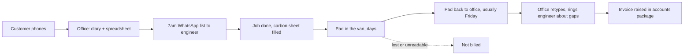
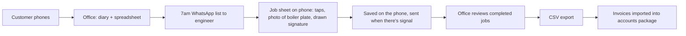

# Facilitator notes: what a good discovery finds

Read this after a run. It's the answer key for workshops and the check for `/ways:discover`. A run doesn't need these words, but it should reach these conclusions, or give a reason for reaching different ones.

## The traps

The pack is built so that the obvious reading is wrong. A run that falls into these hasn't done discovery:

- **The brief is solutions.** Portal, AI scheduling, van map, dashboards. None of them is the problem.
- **The owner's metric isn't the problem.** Sam wants more jobs per day. Priya: "I'm not short of jobs. I'm short of getting paid for them."
- **"We're not starting from scratch."** Most of `app/` should go. The one useful part has a bug that loses data.
- **Interviews and data disagree.** Priya says invoices go out one to three weeks late and one sheet in twenty to twenty-five is lost. The export says a median of 6 days (15 at worst) and 2 lost in 30, about one in fifteen. The lag is smaller than she thinks and the loss is bigger.
- **The data contains a cheaper answer.** Aisha drops her sheets in daily and is invoiced in about a day. The engineers who drop them on Friday wait about eight.
- **The deadline is for the wrong thing.** Sam wants the portal live before winter. The office doesn't want the portal at all.

## 1. Problem and outcome

**Problem:** Brightwater does the work but is slow to bill it and sometimes doesn't bill it at all, because the job record is paper, travels back to the office late, and gets retyped.

Who it hurts: the office (about 12 hours a week of retyping and chasing), the owner (cash flow, unbilled work), and quietly the engineers (phone calls asking what they meant).

**Outcome, measurable from the same spreadsheet:**

- Days from job to invoice: median 6 today; target 1 working day.
- Jobs with no usable sheet: about 1 in 15 today; target none.
- Office time spent retyping: about 12 hours a week today; target under 2.

Also worth noticing: follow-up work gets lost (the flue note on the job sheet that nobody quoted for).

**What the evidence doesn't cover, and a good run says so:**

- **What happens after the invoice.** The pack stops at "invoiced". If customers then take weeks to pay, invoicing faster moves cash less than it looks. Ask Priya how long payment takes and who chases it.
- **Sam hasn't been heard.** He's the buyer, and his goal (more jobs a day) is not the problem found. He has to agree the problem before the scope means anything.
- **Jordan leaves in two weeks.** Whatever is kept from `app/`, ask him this week how it stores data and whether any of it works offline.

## 2. As-is and to-be

As-is:

To-be (MVP):

**The gap is one stretch:** from "job done" to "office has a clean record". Booking, scheduling and the WhatsApp list stay as they are. A run that redesigns booking or scheduling has widened the gap without a reason.

## 3. Personas

- **Engineer** (Tom): works without signal, dirty hands or gloves, won't type, won't remember a password, cares about the signature. Decides: offline-first, taps and photos, no daily login.
- **Office manager** (Priya): owns invoicing, retypes today, wants a clean CSV the accounts package already imports. Decides: the output is a CSV, not a dashboard.
- Sam is the sponsor, not a user of the MVP. Customers don't touch it. Dan is a lighter version of Priya and doesn't need his own persona.

## 4. Scope

**Before building anything:** ask engineers to photograph each finished sheet into WhatsApp, or drop pads daily, for two weeks. It's free, it tests whether faster sheets give faster invoices, and Aisha's numbers suggest it will. It doesn't fix retyping or legibility.

**MVP:** an offline-first job sheet on the phone (taps, a photo of the boiler plate, a drawn signature), queued and sent when there's signal; an office list of completed jobs to check; a CSV export the accounts package imports.

**Next, if the MVP lands:** a text to the customer the day before (Priya's fix for "when's he coming"), and parts used feeding a van-stock list.

**Out, with the reason:**

| Asked for | Why it's out |
|---|---|
| Customer booking portal with deposits | The office doesn't want it (wrong job types, double-booking); the customers are mostly older and phone; deposits add payments to the risk. The day-before text answers the calls it was meant to stop |
| AI scheduling | Serves Sam's metric, not the problem. Priya schedules with knowledge a model doesn't have |
| Live van map | No problem it solves; engineers would resist it; tracking staff carries legal and trust cost |
| Dashboards | Nothing to show until the data is captured. Later, from the same records |
| Stock | Real but second-order. Parts captured on the job sheet are the first step |

**Throw away from `app/`:**

| File | Verdict |
|---|---|
| `portal.html` | Delete: out of scope |
| `map.html` | Delete: out of scope, and it tracks engineers' location |
| `dashboard.html` | Delete: random numbers |
| `auth.js`, `index.html` | Delete: plain-text, shared passwords in code the browser downloads. Engineers need a sign-in they do once per device |
| `jobsheet.html` | Keep the field list as a starting point. Replace the rest: it clears the form before the send succeeds, so offline it loses the job; the signature is a typed name |

## 5. Risks, cost and benefit, estimate, order

**Riskiest assumption:** engineers will fill it in on the phone, at the job. Test it before building: a clickable prototype with Tom and Aisha for a few days.

Other risks: losing a job in offline sync (the thing it's meant to fix); customer names and addresses on personal phones (a lost phone, data protection); the accounts package's CSV format; launching to engineers in the middle of the winter rush; Jordan leaving in two weeks (small, since most of his code goes).

**Benefit, roughly:** at about 120 jobs a week and one in fifteen lost, about 8 jobs a week go unbilled, a little over £1,000 a week at a typical £150 job; plus about 10 hours a week of office time, about 5 days faster cash, and follow-up quotes no longer lost. These are rough, from two weeks' data; say so.

**Cost and estimate:** MVP is **M**: a few weeks for one developer, inside the £15k. The whole brief is **XL** and well over it.

**Order:**

1. Two weeks of the no-build step; measure days to invoice.
2. Prototype the phone job sheet with two engineers.
3. Offline capture and send.
4. Office review list and CSV export; check the import with the accounts package.
5. Boiler-plate photo and drawn signature.
6. Then the day-before text, then parts and stock.

## Checklist for a run

A run on this pack passes if its brief:

- [ ] States the problem as slow and lost billing, not as missing features
- [ ] Gives an outcome with today's number and a target, from the export
- [ ] Notices that interview and data disagree, and trusts the data
- [ ] Names what the evidence doesn't cover: payment after the invoice, Sam's agreement, Jordan's knowledge
- [ ] Draws as-is and to-be, and puts the gap at job done → clean record
- [ ] Has engineer and office personas, each changing a decision
- [ ] Offers a no-build or cheaper step first
- [ ] Puts portal, AI scheduling, van map and dashboards out, with reasons
- [ ] Says what to delete from `app/`, and finds the data-loss bug and the passwords
- [ ] Names engineer adoption, offline, as the riskiest assumption, and how to test it
- [ ] Gives cost and benefit in rough numbers, and a T-shirt size for the MVP
- [ ] Orders the work, smallest useful step first
- [ ] Ends in a hand-off: a brief in `specs/brief/` and an intake issue for `/triage`
